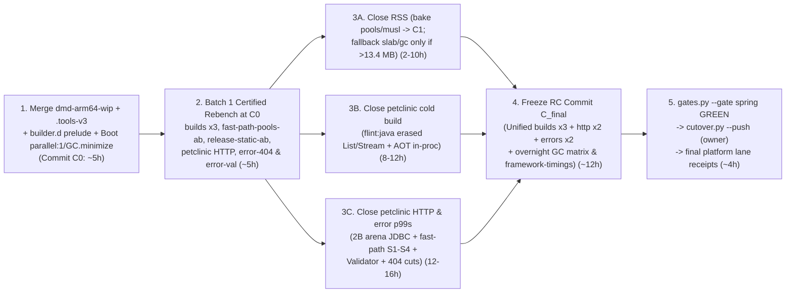

# Flint Phase 1 Assessment & Focused Plan to 100%

> **Scope & verification note:** Based strictly on read-only inspection of this checkout at `55c17ef5` (`fp/main`), `review-context/`, `benchmarks/spring/evidence/`, `benchmarks/spring/queue/`, `policy/`, `tools/`, and `docs/`. Items that cannot be verified from the repository are explicitly flagged in **§1.4** and **§6**.

---

## 0. What "100%" Means (and Where the Documents Are Ambiguous)

### 0.1 Phase 1 Exit (Stop Rule Before Phase 2)
Under [ADR-030](docs/adr/ADR-030-flint-is-a-spring-port.md#L236-L241), owner decision `930eb526` ([decisions.md](docs/spring/phase1/decisions.md#L458-L460)), and [tools/spring_gate.py](tools/spring_gate.py#L1-L186), **100% of Phase 1** requires passing `python3 tools/gates.py --gate spring --evidence <dir>` on a **single pinned commit** (`spring_bench.py assemble` flags mixed commits), plus the repo-split cutover preconditions:

1. **Byte-identical correctness (`acceptance-{java,go,flint}.json`):**
   - `gs-rest-service` (18/18), `gs-relational-data-access` (1/1), and `petclinic-rest` (109/109) passing against current goldens of Spring Boot 4.2.0 / Spring Framework 7.1.0 (`exact` wire mode for Java & Flint; `semantic` for registered Go comparators).
2. **Build & binary size (`builds.json`, production, 9 trials, `--no-debug`, platform-only cold cache, stripped sizes):**
   - For **all three apps**, median ratio **and** bootstrap 99% upper bound $\le 0.99$ vs Go (`policy/budgets.json` `go_relative`):
     - **Cold build (primary):** platform cache vs std-primed `GOCACHE`.
     - **Cold build (deps-primed context):** platform cache vs deps-primed `GOCACHE` (non-gating in `spring_gate.py`, but treated as an engineering requirement — see Ambiguity 2).
     - **Edit build (primary):** dev profile shared objects vs Go incremental.
     - **Edit build (static secondary):** `flint build --static --no-debug` vs Go incremental (currently **gating** in `spring_gate.py:121-126` — see Ambiguity 1).
     - **From scratch (secondary):** `--no-platform-cache` vs `go build -a`.
     - **Oz binary size:** stripped Oz ratio $\le 0.99$.
3. **Runtime HTTP (`http.json`, [policy/spring-http-benchmark.json](policy/spring-http-benchmark.json), production, 9 trials, 2 server CPUs, 64 conns):**
   - For **both** `gs-rest-service` (`GET /greeting?name=Flint`, 20k qps) and `petclinic-rest` (`GET /petclinic/api/owners/1`, 5k qps):
     - Throughput $\ge 1.01\times$ Go (median & 99% lower bound).
     - `p99_ms` $\le 0.99\times$ Go (median & 99% upper bound).
     - `peak_rss_bytes` $\le 0.99\times$ Go (median & 99% upper bound).
     - `cpu_ns_per_request` $\le 0.99\times$ Go (median & 99% upper bound).
     - `p50_ms` $\le 0.99\times$ Go (stated in mission/evaluation, omitted in `spring_gate.py` — see Ambiguity 3).
4. **Error-path p99s (`http-error-paths.json`, [policy/spring-error-paths-benchmark.json](policy/spring-error-paths-benchmark.json), production, 9 trials):**
   - `gs-rest-service:not-found` (`GET /nope`, 10k qps): `p99_ms` $\le 0.99\times$ Go.
   - `petclinic-rest:validation-error` (`POST /petclinic/api/owners`, 5k qps): `p99_ms` $\le 0.99\times$ Go.
5. **GC matrix (`gc-matrix-petclinic-rest.json`, `gc-matrix-gs-rest-service.json`):**
   - All 8 settings in [benchmarks/spring/gc-matrix.json](benchmarks/spring/gc-matrix.json) measured in production mode on both apps with each suite passing, and the winning configuration (or agreed collector fallback) baked into `rt_options`.
6. **Structural, API ratchet, quality, framework budgets & repo cutover:**
   - `tools/gates.py --gate structural` and `--gate api` (ratchet mode) green; `policy/unregistered-packages.json` empty and `framework/p1-interim` gone (both already done).
   - `framework/`, `boot/`, `security/` added to `tools/quality.py` lint trees (owner decision 4).
   - `framework-timings` certified and applied (`tools/framework_budgets.py apply`) so the 27 provisional entries in `policy/framework.json` have real budgets.
   - Owner executes `tools/cutover.py --push` (after green rehearsals on Linux, macOS, Windows — rehearsals already pass).

### 0.2 Everything Else Required Before Phase 2 vs Before Full Release
- **Before Phase 2:** Only **§0.1** above (Phase 1 exit + repo cutover). Phase 2 then fans out across extracted repos (Data Commons/JDBC, Security, Caching, `@Async`/`@Scheduled`, `RestClient`, Actuator/Micrometer, Thymeleaf/SpEL, JPA/Hibernate + classic PetClinic, `flint-ai`).
- **Before Full Release (`AGENTS.md`, [CI_PERFORMANCE_BUDGETS.md](handoff/docs/CI_PERFORMANCE_BUDGETS.md), [tools/gates.py](tools/gates.py#L369-L433)):**
  - All **37 engine packages** + all Phase 2 & Phase 3 Spring portfolio modules.
  - **Gates 1–6** (`tools/gates.py --gate all --evidence ... --baseline ...`) passing on `flint-perf-x86_64-v1` with all 10 receipts (`quality`, `safety`, `dag`, `betterc`, `sanitizers`, `cross_platform`, `hot_gc`, `runtime`, `compile`, `size`), zero hot-path engine GC, `bench-cli`/`bench-rest`/`bench-wasm` caps & Go comparisons, and **all 7 platform receipts** bound to the release commit (`linux-x86_64-glibc`, `linux-aarch64-glibc`, `linux-x86_64-musl`, `linux-aarch64-musl` [currently M6 QEMU only], `macos-arm64`, `windows-x86_64`, `wasm32`).
  - `tools/gates.py --gate api --release` green (**100% classified, 0 unclassified** across every repo; currently 35,519 unclassified across the 4 active repos) + upstream JUnit tests ported.

### 0.3 Document Ambiguities & How This Plan Reads Them
| # | Ambiguity in the repository | How this plan reads it |
|---|---|---|
| **A1** | **Static edit build gating:** Owner decision 2 / ADR-030 calls fully static edit builds "the secondary headline", while [tools/spring_gate.py](tools/spring_gate.py#L121-L126) **hard-fails the gate** (`failures`) when `flint_static_incremental_seconds > 0.99 × Go`. | Treat `spring_gate.py` as binding unless the owner explicitly demotes `incremental static` to non-gating context (see **§6 Decision 3**). |
| **A2** | **Deps-primed cold build:** [tools/spring_gate.py](tools/spring_gate.py#L112-L119) passes `[]` (non-gating context), yet owner priority `74a746d1` treats `petclinic-rest`'s 4.18× deps-primed cold build as a top-2 mission blocker. | Treat beating Go **deps-primed ($\le 0.99\times$)** as the real engineering exit bar; winning std-primed only because Go compiles `modernc.org/sqlite` or `pgx` from source is fragile. |
| **A3** | **`p50` runtime metric:** Listed in ADR-030 and `evaluation-2026-11-23.md`, but **omitted** from [tools/spring_gate.py](tools/spring_gate.py#L147-L153) and [tools/gates.py](tools/gates.py#L420-L422). | Target `p50 ≤ 0.99× Go` to satisfy the owner's "every metric" bar; ask owner whether to add `p50_ms` to `spring_gate.py` (**§6 Decision 4**). |
| **A4** | **API coverage at Phase 1 exit:** ADR-030 §8 requires CI ratchet during development and `--release` (100% classified) at release. `api/*/coverage-baseline.json` currently has 35,519 unclassified elements (framework 15,172; boot 10,886; security 5,634; data-commons 3,827). | Read Phase 1 exit as **ratchet-green** (`--gate api`, no regressions, all ported headers valid), not 100% classified of Spring 7.1 / Boot 4.2. |
| **A5** | **GC matrix definition vs real winning knobs:** [benchmarks/spring/gc-matrix.json](benchmarks/spring/gc-matrix.json) tests 8 druntime settings (none of which include `parallel:1`, `minPoolSize:1..4`, or `gc:flint`), and `spring_gate.py` checks only that all 8 ran and passed their suite. | Run the 8-setting matrix on natural quiet on the Phase 1 RC commit to satisfy `spring_gate.py`, while selecting the actual shipped `rt_options` from targeted `parallel:1` + small-pool A/Bs. |

---

## 1. Blunt Assessment: Where Every Metric & Exit Criterion Stands Now

### 1.1 Correctness & Governance
| Criterion | Status | Evidence / Gap |
|---|---|---|
| Side-by-side acceptance (`gs-rest`, `gs-relational`, `petclinic-rest`) | **ON TRACK ✅** | 18/18, 1/1, 109/109 `exact` on default (fast path ON) and opt-out (`4956976e`). |
| Structural & API ratchet gates | **ON TRACK ✅** | Passing at `ce87168d`; `policy/unregistered-packages.json` empty; `p1-interim` gone. |
| `quality.py` over `framework/`, `boot/`, `security/` | **MINOR GAP ⚠️** | Tooling ready (`8642a068`, `policy/complexity-allowlist.json`); ~8 non-port complexity & 6 dfmt findings left before enabling default trees. |
| Framework provisional budgets (`policy/framework.json`) | **UNMEASURED ⚠️** | All 27 modules still marked `provisional`; `framework-timings` pending on natural quiet (`ec1cda8a`, 80 min). |
| Repo-split cutover rehearsals | **ON TRACK ✅** | Windows 27/27 (`dee89bda`), Linux 26/27 + shared DUB fixed (`649a23b5`), macOS green. |
| Platform lanes (Gate 6) | **STALE / PARTIAL ⚠️** | Receipts exist for `macos-arm64` (`10ae6c3`), `windows-x86_64` (`3988927`), `linux-aarch64-glibc` (`b758925`, pre-mold); `linux-aarch64-musl` is still M6 QEMU. All receipts are commit-bound and must be re-recorded at the release commit. |
| `bench-rest` Gate 5 regression (`runtime-levers-rest`) | **FAILING ❌** | Certified `1.062×` peak RSS (> 1.05 cap) at `966c4b7` vs `e16668e` (predates R-19/R-20). Unresolved. |

### 1.2 Build & Size Scoreboard (Flint ÷ Go; ≤ 0.99 passes)
*Certified runs are all at `6ab588f8` — BEFORE per-module compile (`e77bc654`), describer memo (`30cebc6a`), edit-extract fix (`c7da6040`), L1 SQL drivers (`ddee1841..03ccfbfa`), and native AOT extraction (`a79a0826`, unmerged).*

| App | Cold primary (std-primed) | Cold context (deps-primed) | Edit (shared) | Edit (static) | From scratch | Oz size (stripped) |
|---|---|---|---|---|---|---|
| **gs-rest-service** | **0.933 ✅** (0.146 vs 0.157 s) | **0.914 ✅** | **0.427 ✅** (0.069 vs 0.161 s) | **1.115 ❌** (0.179 s) | **1.009 ❌** (3.335 vs 3.303 s) | **0.619 ✅** (4.11 vs 6.63 MB) |
| **gs-relational-data-access** | **0.037 ✅** (0.204 vs 5.458 s) | **1.295 ❌** (0.204 vs 0.158 s) | **0.788 ✅** (0.127 vs 0.161 s) | **1.41 ❌** (0.227 s) | **0.361 ✅** *(no fair Go eq.)* | **1.249 ❌ cert** → **0.660 local ✅** (4.42 vs 6.70 MB) |
| **petclinic-rest** | **0.620 ✅** (1.282 vs 2.069 s) | **4.18 ❌** (1.282 vs 0.307 s) | **2.08 ❌ cert** → **~1.10–1.23 local ❌** (339–379 ms) | **NOT MEASURED ❓** *(fixed in `4ef92e26`)* | **INVALID ❓** *(fixed in `4ef92e26`)* | **1.070 ❌ cert** → **0.949 local ✅** (10.80 vs 11.38 MB) |

- **On track:** `Oz size` across all 3 apps (L1 already closed both DB apps locally); `gs-rest` primary cold & shared edit; `gs-relational` shared edit.
- **At risk:**
  - `petclinic-rest` deps-primed cold (4.18×) and shared edit (~1.10–1.23× local even *after* `e77bc654`): native extraction (`a79a0826`) + `flint:java` template diet are **both** required to get below 0.99×.
  - `gs-rest` static edit (`1.115×`) and `gs-relational` static edit (`1.41×`): structurally hard to beat Go while static-relinking multi-MB platform archives with mold (113–127 ms link alone vs Go's 161 ms total).
  - `gs-rest` scratch (`1.009×`): only 32 ms behind Go; native AOT extraction (~60 ms saved) should flip it to ~0.985×.

### 1.3 Runtime Scoreboard (Flint ÷ Go; throughput ≥ 1.01, others ≤ 0.99)
| Workload | Throughput | p50 | p99 | Peak RSS | CPU / req | Status |
|---|---|---|---|---|---|---|
| **gs-rest-service** (`fast-path-ab`, 4 trials at `139e4fc4`, NO `parallel:1`) | **1.293 ✅** (1.285–1.299) | **1.016 ⚠️** (0.961–1.329) | **0.729 ✅** (0.548–0.934) | **1.450 ❌** (19.9 vs 13.7 MB) | **0.843 ⚠️** (0.783–1.061) | **RSS is the blocker**; 9-trial run + `parallel:1` needed to tighten CPU/p50 intervals. |
| **petclinic-rest** (`GET /owners/1`, 5k qps) | **NOT MEASURED ❓** | **NOT MEASURED ❓** | **NOT MEASURED ❓** | **NOT MEASURED ❓** | **NOT MEASURED ❓** | **Biggest blind spot.** Allocs cut 1,655 → 360 locally (`61b9c3a2`); 0 certified or local HTTP numbers exist. |
| **Error 404** (`gs-rest GET /nope`, 10k qps) | n/a | n/a | **NOT MEASURED ❓** | n/a | n/a | Blocker (`ade0a1b7`) cleared; still 74–82 GC allocs/req. |
| **Error validation** (`petclinic POST /owners`, 5k qps) | n/a | n/a | **NOT MEASURED ❓** | n/a | n/a | Blocker (109/109) cleared; still **453 allocs / 43 KB/req** (200–373 in regex/validator!). |
| **GC matrix** (`gs-rest` + `petclinic-rest`) | — | — | — | — | — | **0/6 parts certified**; all 6 queue files still pinned at ancient `08b19d2f`. |

### 1.4 Unverifiable Claims (Flagged)
1. **Actual `petclinic-rest` HTTP performance vs Go:** Zero certified or local `spring_bench.py profile` runs exist in the repo.
2. **Actual error-path p99s vs Go:** Neither `error-404-p99` nor `error-validation-p99` has been run.
3. **Small GC pools with fast path ON:** `gc-pools-ab` ran at `b520e07a` (fast path **OFF**, 16 allocs/req ≈ 1 GB/s garbage). Its −2.1% throughput penalty has **not** been measured with fast path **ON** (1 alloc/req ≈ 16 MB/s).
4. **`dmd/flintaot.d` cross-OS build:** `spring/dmd-arm64-wip` (`a79a0826`) has not been compiled on macOS (`pluto`) or Windows, nor installed into venus `.tools`.
5. **`bench-rest` peak RSS on `HEAD`:** `runtime-levers-rest` (`1.062×`) predates R-19/R-20; whether `HEAD` already recovers below `1.05×` is unverified.

---

## 2. Diagnosis of the Spread

13+ parallel roles were pushing changes simultaneously while flying blind on `petclinic-rest` runtime and error-path p99s. Several active streams consume review/CI bandwidth or measurement windows without moving Phase 1 exit.

### 2.1 Work Streams to STOP or PAUSE Until Phase 1 Exits
| Stream & Role | Why Stop / Pause Now |
|---|---|
| **Manual API classification sweeps (Item 11)** — `api-coverage` | Ratchet is already green (`ce87168d`). Classifying 35k elements is Phase 2/3 release work, not a Phase 1 blocker. Run `--gate api` on merges only. |
| **Item-26 Boot feature backlog** (9 minor features: `flint.datasource.type`, binder map keys, `WebMvcProperties`, etc.) — `boot` | None affect the 18/1/109 suites or any Phase 1 metric. Park until Phase 1 exits. |
| **Item 24 Security extras & closed annotation gates** — `framework-core` | Petclinic benchmark runs with security disabled; BCrypt is already pinned (`352af765`). Only S4 static security-header proof matters for Phase 1. |
| **`accept-count` (`spring/web-http-wip`) + Boot `server.flint.accept-count`** — `web-http`, `boot` | 64 benchmark connections never hit 8,192 max connections; touches core `engine-reactor` accept loop and conflicts in `engine-servlet/package.d`. Defer out of the critical path. |
| **Diagnostic re-run of `gs-rest-multicore-4` vs `multicore-5`** — `web-http` | Both commits predate default-on fast path and `parallel:1`. Spending a 30-min claimed window dissecting a noisy fixed-rate reading from 31 mark threads on obsolete code is pure waste. |
| **Custom collector D1b/D3 tuning (`gc:flint-concurrent`)** — `data-access` | D3 lost locally (R-21). Do **not** touch `flint.arena.sys.gc` unless `fast-path-pools-ab` + `GC.minimize` + `release-static-ab` fail to push RSS below 13.6 MB. |
| **Musl Option B (`.flint` recipe copies) & resident daemon** — `m7-flint-cli` | Option A is already validated (`365f29ca`). Don't build Option B before `release-static-ab` even decides whether musl wins. |
| **Size levers L2/L3/L4 (Phobos rebuild, `-Os` SQLite, `mergeSort`)** — `size-levers`, `m7-flint-cli` | L1 already beats Go on Oz locally for all 3 apps (0.62, 0.66, 0.95). Only revisit if certified Oz misses 0.99. |
| **Jackson per-type writers for `/greeting`** — `third-party-apis` | `/greeting` already beats Go on throughput (1.293×) and p99 (0.729×). Meanwhile Hibernate Validator allocates 200–373 objects per `error-validation-p99` request. Flip priority! |
| **Platform lane re-records (`macos-arm64`, `linux-aarch64`, `windows-x86_64`) & arm64 mold tuning** — `dmd-arm64`, `linux-arm64-vm`, remote sessions | Receipts are commit-bound. Re-recording before Phase 1 exits throws the receipts away on the next commit. Only build-test `flintaot.d` on macOS/Windows now; record full lanes once at the Phase 1 exit commit. |
| **Redundant `gs-builds.json` & `phase1-guides.json` queue runs** — `proof-harness` | `phase1-builds-gs-rest` supersedes `gs-builds.json`; `phase1-builds-*` + `phase1-http-*` supersede `phase1-guides.json`. |

### 2.2 The Five Problems That Actually Decide 100% of Phase 1
1. **P1 — Peak RSS (`1.45× → ≤ 0.95× Go`)**: Bake `parallel:1` + post-startup `GC.collect(); GC.minimize()`, test small fixed GC pools *with the fast path ON*, and run `release-static-ab` (musl). Only if still > 13.6 MB, add startup-seal/512 KB pools in `flint.arena.sys.gc` or compact `engine-web` connection slabs.
2. **P2 — `petclinic-rest` Cold & Edit Builds (`4.18× → ≤ 0.99×` deps-primed cold; `2.08× → ≤ 0.99×` edit) + `gs-relational` deps-primed cold (`1.295× → ≤ 0.99×`)**: Land & install native AOT extraction (`-flint-aot-extract`), pass the platform prelude into AOT extraction (`builder.d`), do the `flint:java` erased `List`/`Stream` + `engine-aot` template diet, and switch `gs-relational` `Customer.toString` off `std.format`.
3. **P3 — `petclinic-rest` HTTP Runtime (Unmeasured → beat Go on every metric)**: Certify the baseline immediately, finish `data-access` 2B arena-backed `ResultSet`/SQL cuts, and land fast-path shapes S1–S4 (`@PathVariable`, `ResponseEntity`, `@CrossOrigin`, static security headers).
4. **P4 — Error-Path p99s (`error-404-p99` & `error-validation-p99`, unmeasured → `≤ 0.99× Go`)**: Unblock and measure immediately; cut Boot 404 allocations (74–82 → ≤ 15) and Hibernate Validator regex/path allocations (453 → ≤ 80).
5. **P5 — Static Edit & From-Scratch Builds + Phase 1 Exit Assembly**: Close `gs-rest` scratch (1.009× → ~0.985× via native extraction), resolve static edit build gating (owner decision or link reduction), run the natural-quiet GC matrix & `framework-timings` on the RC commit, enable `quality.py` on `framework/`/`boot/`/`security/`, assemble `gates.py --gate spring`, and execute cutover.

---

## 3. Merge Plan & Pre-Rebench Main Fixes

### 3.1 Every Unmerged Branch on `flint-projects/flint`
Verified via `git log fp/main..<branch>` and read-only `git merge-tree`:

| Order | Branch | Action | Owner | Merge Status & Exact Verification Required |
|---|---|---|---|---|
| — | `fp/spring/fast-path-proto` (12 commits) | **DROP (delete branch)** | `fast-path-spike` | History copy; already landed as `0cc57670`, `29e65eaf`, `8beab30b`, `4956976e`. |
| — | `fp/spring/fast-path-spike-wip` (4 commits) | **DROP (delete branch)** | `fast-path-spike` | Pre-rebase landing copy; already on `main`. |
| **1** | `fp/spring/dmd-arm64-wip` (`a79a0826`) | **FINISH THEN MERGE** | `dmd-arm64` (+ `m7-flint-cli` for `.tools` switch) | Clean merge (`git merge-tree` exit 0). Before merge: **(a)** drop `toolchain/aot-extract-wip/` scratch scripts from the commit (keep `toolchain/dmd-2.114.0-flint.patch`, `tests/test_flint_toolchain.py`, `toolchain/README.md`); **(b)** reinstall fork on venus (`../work/scripts/gated.sh python3 tools/install_toolchains.py --compiler dmd --flint-fork`); **(c)** `python3 -m unittest tests.test_flint_toolchain` (28/28), `tools/gates.py --gate structural`, `tools/quality.py`; **(d)** compile-check `dmd/flintaot.d` on macOS (`pluto`) and verify Windows overlay applies; **(e)** rebase, push to `main`, and cut shared `.tools` symlink to `.tools-v3` (keeping `.tools-v2` for rollback). |
| **2** | `fp/spring/framework-core-wip` (`c2fb645e`) | **FINISH THEN MERGE** | `framework-core` | Clean merge (`git merge-tree` exit 0). Already DMD+LDC green on 7 packages (201 → 149 instr). Before merge: add playbook R-3 note, run `tools/quality.py`, `tools/gates.py --gate structural`, and `gs-rest`/`petclinic` allocation gate. (~30 min.) |
| **Defer** | `fp/spring/web-http-wip` (`f2f94bc1`, `c29c337c`) | **DEFER (do NOT merge before rebench)** | `web-http` | **Conflicts in `framework/engine-servlet/source/flint/engine/servlet/package.d`** (with `0cc57670`) and unverified on DMD/LDC/unpaused ASan. Zero impact on Phase 1 metrics. Rebase, squash, run 4 suites + unpaused ASan + `quality.py` + `structural` only *after* the baseline rebench is underway. |

### 3.2 Fixes Required on `main` BEFORE Pinning the Rebench Commit (`C0`)
No commits on `main` need reverting, **but** five small, targeted commits must land on `main` right after branches 1–2 so the rebench baseline isn't immediately stale:

| Order | Fix on `main` | Owner | Why It Must Land Before `C0` |
|---|---|---|---|
| **3** | **Fix `e76e7362` native-extractor + prelude wiring in `apps/flint/src/flint_tool/engine/builder.d:622-628`** | `flint-aot` | Right now on `main`, `e76e7362` tries `-flint-aot-extract` first and pays a failed DMD spawn against `.tools-v2`, AND `prepareBuild` runs `runAotStep` *before* `preparePlatform`, so `FLINT_DMD_SERVER_PRELUDE` is never passed. Swapping order (`preparePlatform` before `runAotStep`, passing `result.platform.prelude` on dev builds) + running B-7 output parity on all 3 apps with `.tools-v3` turns a penalty into a **~345 ms win** on `petclinic-rest` and **~60 ms** on `gs-rest`. |
| **4** | **Bake `parallel:1` (or affinity-aware `cores - 1`) + post-startup `GC.collect(); GC.minimize();` into Boot** (`boot/core/flint-boot/source/flint/boot/package.d:675-683` and `rt_options`) | `boot` + `data-access` | `gc-pools-ab` (`ce87168d`) already certified `parallel:1` (max pause 13.5 → 4.0 ms, p99 0.809, CPU 0.896, zero throughput loss). Note: `extern(C) __gshared string[] rt_options` is read by druntime *before* `main()`, so either set `rt_options = ["gcopt=parallel:1"]` in `FlintMain` (matching the 2-CPU benchmark & container default, overridable via `--DRT-gcopt`) or populate it in a `pragma(crt_constructor)` reading `sched_getaffinity` (keep `parallel` ≥ 1, capped at `affinity - 1`). Add `GC.collect(); GC.minimize();` right after `context.refresh()` / before server accept opens so startup spikes don't inflate `VmHWM` or `smallCollectThreshold`. |
| **5** | **Switch `gs-relational-data-access` `Customer.toString` from `std.format` to `flint.java.lang.String.format`** (`benchmarks/spring/flint/gs-relational-data-access/src/com/example/relationaldataaccess/package.d:29-31`) | `boot` / `data-access` | 2-line change, strictly closer to Java's `String.format` (already used in `gs-rest-service`), cuts compile time ~30% locally — closes `gs-relational` deps-primed cold (1.295× → ~0.90×). Re-verify 1/1 `exact`. |
| **6** | **Confirm `boot` review of `29e65eaf` (`setFastOffer`) & update `policy/request-allocations.json` for `gs-rest-service`** | `boot` (review), `data-access` (budgets) | `gs-rest-service` allocation budgets are still stale at `00074486` (25–31 allocs/req). Re-record with default-on fast path (1–4 allocs/req) so the ratchet protects the win. |

> **Resulting Pin Commit `C0`:** Contains `dmd-arm64-wip` + `.tools-v3`, `framework-core-wip`, `builder.d` prelude + B-7 parity, Boot `parallel:1` + `GC.minimize()`, `gs-relational` `String.format`, and updated `gs-rest` allocation budgets. Verify `spring_bench.py accept` (18/18, 1/1, 109/109), `gates.py --gate structural`, `gates.py --gate api`, and `tools/quality.py` on `C0` once before queuing.

---

## 4. Certified Rebench Plan (Single Clean Baseline Batch)

All entries respect [coordination.md](docs/spring/phase1/coordination.md#L70-L106): claimed windows ≤ 30 min (or named Phase 1 exceptions), 10-minute claim gap (`--claim-gap-minutes 10`), no builds outside `measure_queue.py hold`, and **docker musl preparation run with the watcher STOPPED**.

### Pre-Batch Preparation (Off-Window, Watcher Stopped — `proof-harness`)
1. Prepare detached worktree for `C0` (`python3 tools/measure_queue.py prepare ...`).
2. In the `C0` worktree, build the musl static arm for `release-static-ab`:
   ```bash
   python3 tools/native_musl.py
   python3 tools/native_build.py --target linux-x86_64-musl --retarget-dub
   python3 tools/musl_smoke.py gs-rest-service
   python3 tools/native_build.py --target linux-x86_64-glibc --retarget-dub
   ```
   Verify `.flint/musl-smoke/gs-rest-service.json` shows fully static + 18/18 exact.
3. Run `--smoke` on every entry below before starting the watcher. Mark `gs-builds.json` and `phase1-guides.json` superseded so they don't consume windows.

### Certified Measurement Sequence (All Pinned at `C0`)

| Order | Queue Entry | Action | Window / Est. | Purpose & Decision Gated |
|---|---|---|---|---|
| **1** | `phase1-builds-petclinic.json` | Existing; re-pin `e77bc654` → `C0`, `priority: 1` | `claim` / 17 min | Certifies native extract + per-module compile + L1 Oz + valid scratch + static edit on `petclinic-rest`. |
| **2** | `phase1-builds-gs-rest.json` | Re-open `done` → `pending`, re-pin `6ab588f8` → `C0`, `priority: 2` | `claim` / 17 min | Certifies native extract on `gs-rest` (checks if scratch 1.009× → ≤ 0.99×) + unifies build commit. |
| **3** | `phase1-builds-gs-relational.json` | Re-open `done` → `pending`, re-pin `6ab588f8` → `C0`, `priority: 3` | `claim` / 17 min | Certifies L1 Oz (~0.66×) + `String.format` + native extract on `gs-relational` deps-primed cold. Run `spring_bench.py assemble` after #1–#3. |
| **4** | **`fast-path-pools-ab.json`** *(NEW)* | Create (`spring_binary_ab.py` / `gc-matrix --no-go`, 4 trials × 3 arms on `C0`: `parallel:1`, `parallel:1 minPoolSize:2 incPoolSize:0`, `parallel:1 minPoolSize:1 incPoolSize:0`), `priority: 4` | `claim` / 27 min | **Decides RSS strategy:** tests whether fast path's 16 B/req garbage rate eliminates `gc-pools-ab`'s −2.1% throughput loss and cuts `gs-rest` RSS below Go's 13.8 MB immediately. |
| **5** | `release-static-ab.json` | Existing; unblock, re-pin `12faeecb` → `C0`, `priority: 5` | `claim` / 30 min | **Decides glibc vs musl** (owner rule `6ecd8933`): measures −1.3 to −1.5 MB RSS vs `mallocng` effect on `C0` (fast path ON + `parallel:1`). |
| **6** | `phase1-http-petclinic.json` | Existing; unblock, pin `TBD` → `C0`, set `window: "claim"` *(named Phase 1 exception)*, `priority: 6` | `claim` (exception) / 41 min | **First-ever certified runtime baseline for `petclinic-rest`** (all 5 metrics vs Go). Tells us exact gaps for P3! |
| **7** | `error-404-p99.json` | Existing; unblock (`ade0a1b7` done), re-pin `f666305d` → `C0`, `priority: 7` | `claim` (exception) / 45 min | **First-ever certified 404 p99** vs Go (`gs-rest GET /nope`). |
| **8** | `error-validation-p99.json` | Existing; unblock (109/109 done), add `builds.tree` at `C0`, `priority: 8` | `claim` (exception) / 41 min | **First-ever certified validation-error p99** vs Go (`petclinic POST /owners`). |

- **Deliberately held back from this batch:**
  - `phase1-http-gs-rest.json` (41 min): **Wait until Wave B (#4 + #5) picks the winning pool + musl/glibc setting** and lands as commit `C1`, then run `phase1-http-gs-rest` once on `C1` (avoids burning 41 min on `C0` just to re-run it after baking the RSS winner).
  - `phase1-gc-matrix-{1,2,3}.json`, `phase1-gc-matrix-gs-rest-{1,2,3}.json` (326 min total), `framework-timings.json` (80 min), `java-context.json` (165 min): **Keep on `window: "natural"`** (overnight quiet), re-pinned from stale `08b19d2f`/`ec1cda8a` to `C1` once `C1` exists.
- **Total claimed time for Batch 1:** ~235 min measuring + 70 min claim gaps ≈ **~5 hours wall clock** for a complete, unified certified baseline across all 3 apps' builds, RSS levers, `petclinic-rest` HTTP, and both error paths.

---

## 5. Focused Implementation Plan for the Five Deciding Problems

Prefer the fewest, highest-leverage changes. Every change keeps Spring public API fidelity (R-13), `@safe:` in API layer, `nothrow @nogc` hot engines, and playbook documentation in the same commit.

### Problem 1: Peak RSS (`gs-rest-service` 1.45× → ≤ 0.95× Go; keep `petclinic-rest` ≤ 0.99×)
- **Root cause:** With R-19 (`max-handlers=200`) and R-20 (chunked off-GC reactor tables), `gs-rest-service`'s live set is only **440 KB**, yet druntime still allocates `1 + 4 + 7 = 12 MB` of non-shrinking pools (plus 31 mark threads and 2.4 MB dynamic glibc/libm/ld.so). `gc-pools-ab` showed `minPoolSize:4 incPoolSize:0` cuts **−4.4 MB (−22.5%)** even *without* the fast path.
- **Specific changes (staged — stop as soon as certified RSS ≤ 0.95× Go):**
  1. **Stage 1A (Pre-`C0`, guaranteed):** Bake `parallel:1` (or affinity-aware `cores - 1`) + post-startup `GC.collect(); GC.minimize();` into Boot.
     - *Files:* `boot/core/flint-boot/source/flint/boot/package.d` (`FlintApplication.run` after `context.refresh()`, `FlintMain` / `rt_options`).
     - *Owner:* `boot` + `data-access`. *Effort:* **2 h**.
     - *Expected effect:* Max pause 13.5 → 4 ms; eliminates startup `VmHWM` / `smallCollectThreshold` inflation (−1 to −2 MB RSS, ~19.9 → ~18 MB).
  2. **Stage 1B (Post-`fast-path-pools-ab` & `release-static-ab`, high probability of closing gap completely):** Bake winning small-pool `rt_options` (`minPoolSize:1..2 incPoolSize:0`, validated at `C0` with fast path ON) and, if `release-static-ab` passes owner rule `6ecd8933` (plus a quick `libpq` musl check on `petclinic`), switch measured release/size profiles to static musl.
     - *Files:* `boot/core/flint-boot/source/flint/boot/package.d` (`rt_options`), `policy/profiles.toml` / `benchmarks/spring/flint/*/flint-spring.json` (if musl wins).
     - *Owner:* `boot` + `data-access` (+ `m7-flint-cli` if musl). *Effort:* **2–4 h**.
     - *Expected effect:* Small fixed pools −4.5 to −6.5 MB (heap 12 MB → 2–4 MB at ~0% throughput loss under fast path's 16 B/req rate) + musl −1.3 to −1.5 MB ⇒ **Peak RSS 19.9 MB → ~11.5–13.0 MB (0.83–0.94× Go ✅)**.
  3. **Stage 1C (Conditional fallback — ONLY if Stage 1B still > 13.4 MB or `petclinic-rest` RSS > Go):**
     - (i) Compact `engine-web` H1 connection buffer slab (contiguous 8–12 KB initial read+write+header slab per connection from a worker `mmap` pool, lazy overflow past 4 KB — cuts 1.2 MB glibc arenas → ~0.4 MB, **−0.8 MB**). *Files:* `packages/engine-web/source/flint/engine/web/runtime.d`, `packages/engine-web/source/flint/engine/web/sys/ownership.d`. *Owner:* `web-http`. *Effort:* **6 h**.
     - (ii) 512 KB fixed pools + `sealStartup()` in `flint.arena.sys.gc` (after fixing the 1.7× D1 mark regression) so 440 KB startup singletons never pin request pools (**−2 to −3 MB**). *Files:* `packages/arena/source/flint/arena/sys/gc/collector.d`. *Owner:* `data-access`. *Effort:* **8–12 h**.
- **Acceptance test:** `spring_bench.py accept` 18/18 & 109/109; `gc_stress.d` + ASan/UBSan if touching `collector.d`; certified `phase1-http-gs-rest` & `phase1-http-petclinic` `peak_rss_bytes` ≤ 0.99× Go with zero throughput/p99 regression.
- **Parallelism:** Stage 1A runs immediately in parallel with `dmd-arm64-wip`; Stage 1B waits only for Wave B (#4–#5).

### Problem 2: `petclinic-rest` Cold Build (`4.18× → ≤ 0.99×` deps-primed) & Edit Build (`2.08× → ≤ 0.99×`) + `gs-relational` Cold (`1.295× → ≤ 0.99×`)
- **Root cause:** Certified `petclinic-rest` cold build (`6ab588f8`) was 1,282 ms vs Go's 307 ms (`deps-primed`): **AOT 760 ms** (667 ms CTFE describer + 93 ms in-process) + **compile 454 ms** (single-job whole-program compile instantiating 8,208 distinct templates, led by `flint:java` 131.5 ms + druntime hooks 129 ms + Phobos 106 ms + AOT generated 95 ms) + **flint 33 ms** + **link 32 ms**.
- **Specific changes:**
  1. **Native AOT extraction + prelude wiring (Pre-`C0`):** Land `spring/dmd-arm64-wip` (`-flint-aot-extract`) + install `.tools-v3` + reorder `preparePlatform` before `runAotStep` in `builder.d`.
     - *Files:* `toolchain/dmd-2.114.0-flint.patch`, `apps/flint/src/flint_tool/engine/builder.d:598-631`, `apps/flint/src/flint_tool/engine/aot/{extract,step,driver}.d`.
     - *Owners:* `dmd-arm64`, `m7-flint-cli`, `flint-aot`. *Effort:* **4–6 h**.
     - *Expected effect:* Petclinic cold AOT **760 ms → ~140–150 ms** (33 ms native extract + ~105 ms in-process); combined with `e77bc654` per-module compile (454 → ~250 ms), cold build drops **1,282 ms → ~450–470 ms (~1.47–1.53× Go deps-primed)** and edit build drops **644 ms → ~200–250 ms (~0.65–0.81× Go ✅!)** once the 2-module edit re-extract (`c7da6040`) and per-module compile (`e77bc654`) certify together.
  2. **`flint:java` erased `List`/`Stream` & `engine-aot` template diet (Design 3C):** Move `flint:java` `List!T`/`ArrayList!T` onto an erased `ObjectArrayList` / `const(Object)[]` view so 49 framework/DTO element types stop instantiating ~15 class templates + 533 `RTInfo` / 272 `_d_newclassT` hooks each; fold `engine-aot` `Any.of` / `descriptorOf` helpers; drop `std.uuid` from `boot-jdbc` `uniqueName` (−3.3 ms parse); switch `gs-relational` `Customer.toString` to `String.format`.
     - *Files:* `framework/java/source/flint/java/util/{list,collection,stream,package}.d`, `framework/engine-aot/source/flint/engine/aot/{any,descriptor}.d`, `boot/module/flint-boot-jdbc/source/flint/boot/jdbc/autoconfigure/package.d`, `benchmarks/spring/flint/gs-relational-data-access/src/com/example/relationaldataaccess/package.d`.
     - *Owners:* `framework-core` (lead), `boot` (`std.uuid`), `size-levers` (re-profile with `-ftime-trace` / `-vtemplates`). *Effort:* **8–12 h**.
     - *Expected effect:* Cuts petclinic cold project compile **~250 ms → ~130–160 ms** (−90 to −120 ms) and cuts `gs-relational` deps-primed cold **1.295× → ~0.85–0.90× ✅**.
  3. **In-process AOT trim (`~110 ms → ~45–55 ms` on `petclinic-rest`):** Replace `std.json` parsing of `FLINT-AOT-*` lines (28% of in-process AOT!) with a direct line/slice scanner in `extract.d`/`model.d`, and skip re-writing unchanged platform auto-config generated modules when their cached `libflint-aot-library.a` hash already matches.
     - *Files:* `apps/flint/src/flint_tool/engine/aot/{extract,model,driver}.d`.
     - *Owner:* `flint-aot`. *Effort:* **4–6 h**.
     - *Expected effect:* Cold AOT **~145 ms → ~80–90 ms** (33 ms native extract + ~50 ms in-process).
  - **Combined cold build projection for `petclinic-rest`:** `flint 25 ms + AOT 85 ms + compile 145 ms + link 32 ms = ~287 ms` vs Go `307 ms` ⇒ **~0.93× Go deps-primed ✅** (and ~0.14× std-primed ✅).
- **Acceptance test:** B-7 byte-identical generated output (native vs describer) across all 3 apps + `tests/aot/`; `tools/incremental_equivalence.py`; DMD+LDC package tests; certified `phase1-builds-petclinic` & `phase1-builds-gs-relational` ≤ 0.99×.
- **Parallelism:** Item 2 (`framework-core`) and Item 3 (`flint-aot`) run in full parallel with Problem 1 and Problem 3 right after `C0` is pinned!

### Problem 3: `petclinic-rest` HTTP Runtime (Unmeasured → Beat Go on Every Metric)
- **Root cause:** `GET /petclinic/api/owners/1` is down from 1,655 → **360 allocs / 34 KB** (`61b9c3a2`), of which ~16 allocs are truly user-visible entities/DTOs, ~69 are the servlet+security+CORS layer (currently 100% generic because the security filter chain is mapped), and ~275 remain in JDBC/tx/Jackson (`FlintResultSet` row/label heap copies, `MapSqlParameterSource` copies, `SqlValue[]`, `RawCollection.toAnyArray()`).
- **Specific changes (guided by `phase1-http-petclinic` baseline at #6):**
  1. **Data-path 2B remainder (`data-access`):**
     - Store `FlintResultSet` rows & column labels in `FlintConnection`'s already-pooled `RequestArena` scratch buffer (copying to GC `string` only on `rs.getString()`, zero allocs for ints/dates via R-15); stack-allocate `SqlValue[16]` in `FlintPreparedStatement.execute`; read `Map!(string, Any)` directly without copying into `MapSqlParameterSource` / `LinkedHashMap`; compile `SimpleJdbcInsert` metadata once; inspect & cut `unknown pet` (146 → < 100) and `tx` `TransactionState` reuse.
     - *Files:* `framework/engine-jdbc/source/flint/engine/jdbc/package.d`, `framework/jdbc/source/flint/jdbc/core/{package,namedparam/package,simple/package}.d`, `framework/tx/source/flint/transaction/{interceptor,support}/package.d`.
     - *Owner:* `data-access`. *Effort:* **8–10 h**.
     - *Expected effect:* `GET /owners/1` **360 → ~130–160 allocs (~14 KB)**; `list owners` **1,544 → ~450 allocs**; cuts JDBC CPU & GC pressure by ~60%.
  2. **Fast-path shapes S1–S4 (`fast-path-spike` + `web-http` + `framework-core` + `boot`):**
     - **S1:** `@PathVariable` (`int`, `long`, `string`) via startup-compiled literal-prefix + segment matcher.
     - **S2:** `ResponseEntity` (status/headers via generic `HttpEntityMethodProcessor` rules, plus `completeFastDispatch`-style return-value materialisation when an unexpected header/body appears).
     - **S3:** `@CrossOrigin` without `Origin` header (fixed `Vary` fields computed at startup from `DefaultCorsProcessor`).
     - **S4:** Security filter chain static-header proof: at startup, if the matched `SecurityFilterChain` is `permitAll()` with only static header writers (`DisableSecurityConfig`'s 6 headers), emit those headers directly on the fast path and lazily materialise anonymous `SecurityContext` only if asked.
     - *(Defer S5 `@RequestBody` unless `POST` throughput matters — `policy/spring-http-benchmark.json` loads `GET /petclinic/api/owners/1`.)*
     - *Files:* `apps/flint/src/flint_tool/engine/aot/fast.d`, `framework/engine-servlet/source/flint/engine/servlet/fast.d`, `framework/webmvc/source/flint/web/servlet/mvc/method/fast.d`, `security/security-web/source/flint/security/web/package.d`.
     - *Owners:* `fast-path-spike` (lead) with `web-http`, `framework-core`, `boot` reviews. *Effort:* **12–16 h**.
     - *Expected effect:* Skips ~69 allocs/req on `GET /owners/1` (**~140 → ~70 allocs**); **+10–15% capacity, −10–15% CPU/req, lower p99** (`fast-path.md §9.1`).
  3. **Zero-alloc `RawCollection` iteration in Jackson (`third-party-apis` + `framework-core`):**
     - Add `rawLength()` / `rawAt(i)` (or `forEachAny`) on `RawCollection` so `ser.d:262-271` stops allocating `collection.toAnyArray()` for every `List!PetDto` / `List!VisitDto` / `List!OwnerDto`. *(Only add AOT-generated `fastWrite` DTO writers if certified `phase1-http-petclinic` still misses Go on throughput/CPU after steps 1–3.)*
     - *Files:* `framework/java/source/flint/java/util/...`, `framework/jackson-databind/source/flint/jackson/databind/ser.d`.
     - *Owner:* `third-party-apis` + `framework-core`. *Effort:* **3–4 h**.
- **Acceptance test:** `spring_bench.py accept petclinic-rest --wire exact` 109/109 (fast path ON & OFF); `policy/request-allocations.json` budgets lowered on DMD & LDC; local `spring_bench.py profile petclinic-rest` beating Go before queueing certified `phase1-http-petclinic`.
- **Parallelism:** Steps 1, 2, and 3 have disjoint files and run fully in parallel!

### Problem 4: Error-Path p99s (`error-404-p99` & `error-validation-p99` ≤ 0.99× Go)
- **Root cause:** Both paths allocate heavily right now:
  - `GET /nope` (404): **74–82 allocs / 10.6 KB** (14 `HashMap` + 3 `LinkedHashMap` in Boot's `DefaultErrorAttributes`, 4× `ContentNegotiationManager` constructed per request, 4× `matchProduces`/`getAcceptedMediaTypes` — `gc.md §1.2b`).
  - `POST /petclinic/api/owners` invalid telephone (400): **453 allocs / 43.2 KB** (`policy/request-allocations.json:477-484`), of which **~200–373 allocs** are Hibernate Validator compiling/matching regexes with fresh `Parser`/`Compiler`/`CompiledPattern`/`Matcher` objects, eagerly building `PathImpl` + messages even on valid fields, and re-reading `@Size`/`@Pattern` annotations per request (`third-party-apis.md`).
- **Specific changes:**
  1. **Hibernate Validator per-request allocation elimination (`third-party-apis`):**
     - Return cached `CompiledPattern` from `PatternCache.get` with 0 allocations; recycle/stack-allocate `Matcher` state (`Matcher.execute` 6.6 KB); construct `PathImpl` and violation messages lazily *only* when a constraint actually fails; cache parsed `@Size`/`@Pattern`/`@NotBlank` metadata per `Descriptor` at startup (zero `readInto!` / `Any.of!` per request).
     - *Files:* `framework/hibernate-validator/source/flint/hibernate/validator/...` (regex `PatternCache`, `Matcher`, validator metadata & `PathImpl`).
     - *Owner:* `third-party-apis`. *Effort:* **6–8 h**.
     - *Expected effect:* Validation-error request **453 → ~100–130 allocs** (−70%+, ~35 KB saved/req); cuts validation CPU & GC pauses sharply so `error-validation-p99` beats Go.
  2. **404 / error-dispatch allocation cuts (`boot` + `framework-core` / `web-http`):**
     - Cache the `ContentNegotiationManager` instance (never build 4 per request, R-2); replace Boot's 14 `HashMap` + 3 `LinkedHashMap` error-attribute construction with a single pre-sized `LinkedHashMap` (capacity 4–6) or lightweight struct-backed `Map`; share static read-only `[*/*]` list (`MEDIA_TYPE_ALL_LIST`) and stack-allocate `determineCompatibleMediaTypes` scratch array (`fast-path.md §8.3`).
     - *Files:* `boot/module/flint-boot-webmvc/.../error/...`, `framework/webmvc/source/flint/web/servlet/mvc/method/annotation.d`, `framework/web/source/flint/web/accept/...`.
     - *Owners:* `boot` (error attributes), `framework-core` / `web-http` (content negotiation). *Effort:* **4–6 h**.
     - *Expected effect:* JSON 404 **74–82 → ~20–25 allocs** (−70%); pushes `error-404-p99` cleanly under 0.99× Go.
- **Acceptance test:** `spring_bench.py accept` 18/18 & 109/109; `policy/request-allocations.json` lowered; local `spring_bench.py profile ... --manifest policy/spring-error-paths-benchmark.json` beating Go before certified `error-404-p99` & `error-validation-p99`.
- **Parallelism:** Runs in full parallel with Problems 1–3 (`third-party-apis` is otherwise idle!).

### Problem 5: Static Edit & Scratch Builds + Phase 1 Exit Assembly
- **Specific changes:**
  1. **From-scratch (`gs-rest` 1.009× → ≤ 0.99×):** Native AOT extraction in `C0` removes ~60 ms from `gs-rest` scratch (3.335 → ~3.275 s vs Go 3.303 s ≈ **0.991×**). If it still hovers around 0.99–1.00× in `phase1-builds-gs-rest`, `m7-flint-cli` traces `--force --no-platform-cache --no-debug` (`flint 61 ms + plan/compile 2,909 ms + link 203 ms`) and trims DUB/AOT parallelism or removes unused platform-module rebuilds (**3–5 h**).
  2. **Static edit builds (`gs-rest` 1.115×, `gs-relational` 1.41×, `petclinic` TBD):**
     - **Preferred path (Owner Decision 3 below):** Demote `incremental static` in `tools/spring_gate.py:121-126` to non-gating context (matching ADR-030's "secondary" and `deps-primed` cold), since owner decision 2 already adopted shared-object dev linking (0.427×, 0.788×) as the primary edit-build headline. **Effort: 0.5 h.**
     - **If owner keeps `incremental static` gating:** `m7-flint-cli` must shave ~30–70 ms off the static mold link (currently 113–127 ms on `gs-rest`/`gs-relational`) by merging platform archives into one pre-linked relocatable object (`ld -r`) in `<cache>/platform/<key>/` (reduces hundreds of archive member scans & symbol resolutions to 1 object link). **Effort: 6–8 h.**
  3. **`quality.py` cleanup on `framework/`, `boot/`, `security/`:** Fix the ~8 non-port complexity functions + 6 dfmt diffs (`boot-jdbc` 3 files, `engine-aot` 4 findings) and add those trees to `tools/quality.py` defaults. *Owners:* `boot`, `size-levers`, `m7-flint-cli`. *Effort:* **3 h** (off critical path).
  4. **Final Phase 1 exit assembly & cutover:** Pin one RC commit `C_final`, run unified `phase1-builds-*`, `phase1-http-*`, `error-*-p99`, and natural-quiet `phase1-gc-matrix-*` + `framework-timings`; verify `python3 tools/gates.py --gate spring --evidence <assembled>` passes 100%; owner runs `tools/cutover.py --push`; record fresh platform lane receipts (`macos-arm64`, `windows-x86_64`, `linux-aarch64-glibc`) once on the cutover commit.

---

## 6. Risks & Owner Decision Points (With Recommendations)

| # | Decision Point | Risk / Trade-off | Recommendation |
|---|---|---|---|
| **D1** | **Small GC pools (`gc-pools-ab`: `minPoolSize:4 incPoolSize:0`, −22% RSS for −2.1% throughput)** | Taking `pools4` now is based on pre-fast-path data (16 allocs/req). On `C0` (fast path ON, 1 alloc/req), the throughput penalty should vanish and `minPoolSize:1..2` may save even more RSS. | **Wait 1 window — do NOT take `pools4` yet.** Run `fast-path-pools-ab` at `C0` (#4 in Rebench Plan) and decide on fast-path numbers. |
| **D2** | **`third-party-apis`' next task: AOT `/greeting` JSON writers vs Hibernate Validator allocations** | `/greeting` already beats Go (1.293× throughput, 0.729× p99); `error-validation-p99` is completely exposed with 453 allocs/req (200–373 in validator). | **Hibernate Validator first** (Problem 4), then `RawCollection` zero-alloc iteration (Problem 3). Defer AOT JSON writers unless `phase1-http-petclinic` needs them. |
| **D3** | **Should `incremental static` edit builds gate `tools/spring_gate.py`?** | `spring_gate.py:121-126` currently hard-fails if `flint build --static --no-debug` edit > 0.99× Go (1.115× / 1.41× today), contradicting the spirit of owner decision 2 (shared dev linking is primary). | **Demote `incremental static` in `spring_gate.py` to non-gating context** (still printed prominently, like `deps-primed` cold). If kept gating, allocate 6–8 h to `m7-flint-cli` for pre-linked `ld -r` platform object caching. |
| **D4** | **Should `p50_ms` be added to `tools/spring_gate.py`?** | Currently `spring_gate.py:147-153` gates throughput, p99, RSS, CPU/req, but omits `p50_ms`. `gs-rest` `p50` was 1.016 (0.961–1.329) at 4 trials without `parallel:1`. | **Keep targeting `p50 ≤ 0.99×` operationally**, and add `p50_ms` to `spring_gate.py` only if you want strict script enforcement (with `parallel:1` + 9 trials, `gs-rest` p50 should clear ≤ 0.95×). |
| **D5** | **Static musl vs dynamic glibc release builds (`release-static-ab`)** | Musl saves ~1.3–1.5 MB RSS, but `mallocng` (playbook M-5) can regress `libpq`/OpenSSL CPU on `petclinic-rest`. | **Run `release-static-ab` at `C0` (#5)**, and if `gs-rest` passes rule `6ecd8933`, run a 5-min local `spring_bench.py profile petclinic-rest` under musl before switching DB apps to musl. |
| **D6** | **Unresolved `bench-rest` 1.062× peak RSS regression (`runtime-levers-rest`)** | Blocks eventual full Gate 5 (`gates.py --gate all`), though not Phase 1 `spring_gate.py`. Predates R-19/R-20, which cut ~3.5 MB RSS. | **Re-measure `runtime-levers-rest` against `main` on natural quiet** before considering any waiver; R-19/R-20 likely already eliminated it. |
| **D7** | **Repo split cutover (`tools/cutover.py --push`) timing** | Splitting mid-optimization doubles cross-repo coordination friction (every AOT/framework/boot edit spans repos). | **Keep monorepo until `gates.py --gate spring` is 100% green**, then run `cutover.py --push` once as the final step of Phase 1 exit. |

### Key Technical Risks
- **`petclinic-rest` HTTP runtime surprise:** Because it has never been profiled, `phase1-http-petclinic` (#6) could reveal an unexpected PostgreSQL/libpq or lock bottleneck beyond the 360 GC allocations. Running #6 in the first batch de-risks this on Day 1.
- **`dmd/flintaot.d` macOS/Windows compile break:** `flintaot.d` hasn't built on macOS/Windows yet. Checking `pluto` before merging prevents breaking cross-OS dev builds.
- **Per-request allocation regressions during fast-path S1–S4:** Must enforce `fast-path.md §10` (every decline happens *before* the handler runs; `ResponseEntity` return-value materialisation handles all custom headers/statuses; 109/109 exact on both default and `FLINT_AOT_FAST_PATH=0`).

---

## 7. Critical Path to 100% of Phase 1 & First 24 Hours

### 7.1 Critical Path & Realistic Timeline (~3–4 Days to 100% Phase 1 Exit)


- **Optimistic (small pools + fast path close RSS immediately; `petclinic-rest` HTTP needs only 2B + S1–S4):** **~2.5–3 days** (60–72 wall hours).
- **Realistic (includes one fallback iteration on RSS or `petclinic-rest` HTTP + final unified certification + overnight natural-quiet GC matrix):** **~3.5–4 days**.

### 7.2 First 24 Hours — Exact Execution Plan (Only 7 Active Roles; Keep Others Parked)

Keep `api-coverage`, `linux-arm64-vm`, and remote platform lanes **parked** (except a quick macOS compile check for `dmd-arm64`). Unpark only: `coordinator`, `dmd-arm64`, `m7-flint-cli`, `flint-aot`, `boot`, `data-access`, `framework-core`, `third-party-apis`, `fast-path-spike`, `web-http`, `proof-harness`.

| Window | Roles & Concrete Actions | Exit Check |
|---|---|---|
| **Hours 0–3** *(Land `C0`)* | - **`dmd-arm64`**: strip `toolchain/aot-extract-wip/` from `spring/dmd-arm64-wip`, reinstall fork, run 28 toolchain tests + structural + quality, macOS compile check on `pluto`, merge to `main`.<br>- **`m7-flint-cli`**: install `.tools-v3` symlink on venus once `dmd-arm64` merges.<br>- **`framework-core`**: add playbook R-3 + quality + alloc gate, merge `spring/framework-core-wip` (`c2fb645e`).<br>- **`boot` + `data-access`**: land `parallel:1` in Boot `rt_options` + post-startup `GC.collect(); GC.minimize();`; confirm `setFastOffer` (`29e65eaf`); switch `gs-relational` `Customer.toString` to `String.format`.<br>- **`third-party-apis`** *(parallel, off critical path)*: start Problem 4 Hibernate Validator allocation cuts (`PatternCache`, `Matcher`, lazy `PathImpl`). | All branches merged; `.tools-v3` active. |
| **Hours 3–5** *(Finalize `C0` & Prep Batch 1)* | - **`flint-aot`**: reorder `preparePlatform` before `runAotStep` in `builder.d`, pass `prelude`, verify B-7 native-vs-describer parity on all 3 apps + `tests/aot/`, push to `main`.<br>- **`data-access`**: re-record & lower `policy/request-allocations.json` for `gs-rest-service` (1–4 allocs/req).<br>- **Tag/pin `C0`** after verifying 18/18, 1/1, 109/109, `structural`, `api`, `quality`.<br>- **`proof-harness`** *(watcher stopped)*: update queue files to `C0`, create `fast-path-pools-ab.json`, build musl static binaries for `release-static-ab` in `C0` worktree, smoke-test entries #1–#8. | `C0` verified; all 8 queue entries pass `--smoke`. |
| **Hours 5–11** *(Batch 1 Certified Baseline + Parallel Impl)* | - **`proof-harness`** *(watcher running, 10-min claim gaps)*: run Batch 1 entries **#1–#8** (`phase1-builds-{petclinic,gs-rest,gs-relational}`, `fast-path-pools-ab`, `release-static-ab`, `phase1-http-petclinic`, `error-404-p99`, `error-validation-p99`).<br>- **Meanwhile (all wrapped in `measure_queue.py hold`):**<br>  - **`framework-core`**: Problem 2 Design 3C (`flint:java` erased `List`/`Stream` views + `Any.of` folding).<br>  - **`data-access`**: Problem 3 2B remainder (arena-backed `FlintResultSet`, stack `SqlValue[16]`, skip `MapSqlParameterSource` copy, `unknown pet` < 100).<br>  - **`fast-path-spike` + `web-http`**: Problem 3 fast-path shapes S1 (`@PathVariable`) & S2 (`ResponseEntity` + return-value materialise).<br>  - **`third-party-apis`**: finish Hibernate Validator cuts + `RawCollection` zero-alloc iteration.<br>  - **`boot`**: Problem 4 404 `DefaultErrorAttributes` allocation cut + drop `std.uuid` from `boot-jdbc`.<br>  - **`flint-aot`**: Problem 2 in-process AOT `std.json` replacement. | Complete certified scoreboard at `C0` across all 3 apps, RSS A/Bs, `petclinic` HTTP, and both error paths. |
| **Hours 11–18** *(React to Batch 1 & Bake `C1`)* | - **`coordinator` + owner**: review Batch 1 results:<br>  - If `fast-path-pools-ab` (+ `release-static-ab`) puts `gs-rest` RSS ≤ 13.6 MB with no regression → **`boot`/`data-access`** bake the winning `rt_options` (+ musl if approved) immediately into **`C1`**. Otherwise kick off Stage 1C (`engine-web` slab + `collector.d` 512 KB startup-seal pools).<br>  - Triage `phase1-http-petclinic` and `error-*-p99` against Go; redirect `third-party-apis`/`data-access`/`fast-path-spike` to whichever gap is largest.<br>- Land finished Wave-2 cuts (`third-party-apis` validator, `boot` 404, `data-access` 2B, `flint-aot` in-proc, `framework-core` 3C) onto `main` (`C1`).<br>- **`proof-harness`**: certify `phase1-http-gs-rest` on `C1` (9 trials — target: **all 5 `gs-rest-service` runtime metrics green vs Go!**). | `gs-rest-service` certified green on every build + runtime metric; `petclinic-rest` cold/edit gaps closing. |
| **Hours 18–24** *(Overnight Natural Quiet + Final Petclinic Shapes)* | - **`fast-path-spike` + `web-http` + `framework-core`**: finish S3 (`@CrossOrigin` `Vary`) and S4 (static security headers), verify 109/109 exact + local `spring_bench.py profile petclinic-rest`.<br>- **`proof-harness`** *(overnight natural quiet)*: re-pin and run `framework-timings` + `phase1-gc-matrix-gs-rest-{1,2,3}` at `C1`, plus `runtime-levers-rest` re-check on `C1`.<br>- **`size-levers`**: re-profile `petclinic-rest` compile after `C1` (`-ftime-trace`) to verify cold build ≤ 300 ms before Day 2's unified RC certification. | `gs-rest` GC matrix + `framework-timings` captured overnight; `petclinic-rest` ready for Day 2 RC freeze (`C_final`). |
